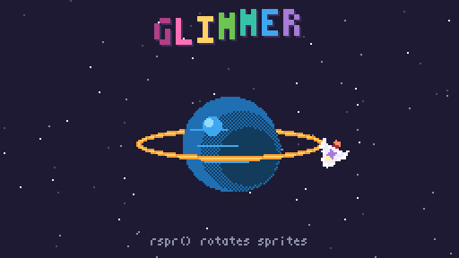

<div align="center">

<picture>
  <source media="(prefers-color-scheme: dark)" srcset="docs/assets/banner-dark.png">
  <source media="(prefers-color-scheme: light)" srcset="docs/assets/banner-light.png">
  
</picture>

**Make tiny games in Lua. Draw them, score them, and share them as a picture.**

[](https://github.com/aubergine-ux/glimmer/actions/workflows/ci.yml)
[](https://github.com/aubergine-ux/glimmer/releases)
[](LICENSE)
[](#install)
[](https://armd.one/glimmer/)

<br>


<br><br>

<a href="https://armd.one/glimmer/"></a>

</div>

<br>

Glimmer is an open-source **fantasy console**: a pretend retro computer with
deliberately tight limits and everything you need to make a game inside it.
You get 256×144 pixels, 32 colors, 4 sound channels and a fixed CPU budget,
and you write the game in Lua. The limits are the fun part. They keep games
small enough to finish, and because every machine runs a cart exactly the
same way, you can share a game as a single file, or as a PNG of a cartridge
that *is* the game.

## ✨ Features

- 🎨 **Pixel-perfect graphics:** sprites you can flip, stretch and rotate, a
  4-layer tile map, shapes, fill patterns, clipping, a camera, palette swaps,
  and a built-in pixel font.
- 🎹 **A real synthesizer:** 4 channels, 8 waveforms plus custom wavetables,
  slides, vibrato and arpeggios, all generated live and sample-accurate.
- 🌙 **Lua 5.4:** `_init`, `_update` and `_draw`, a friendly API, and an error
  screen that points at the exact line.
- ⏱️ **Fair everywhere:** a fixed 1M-cycle frame budget, so a game runs the
  same on a gaming PC, a laptop and a phone browser.
- 🖼️ **Carts as pictures:** export any game as a PNG cartridge with the whole
  game hidden in its pixels. Post it anywhere and anyone can play it.
- 🕹️ **Up to 4 players:** gamepads, rebindable keys, mouse and keyboard.
- 📺 **Integer scaling and a CRT filter:** crisp pixels at any window size, or
  curved glass and scanlines at the press of <kbd>F9</kbd>.
- 🌐 **Runs in the browser:** the same console compiled to WebAssembly.
- 🧪 **Built to last:** a versioned [spec](SPEC.md), so carts keep working
  forever, and CI on Windows, macOS, Linux and the web.

> **Coming next:** built-in code, sprite, map, sound and music editors, a
> console shell, a debugger, and a cart browser. See the [roadmap](#roadmap).

## 🕹️ Demo carts

<table>
  <tr>
    <td align="center" width="50%">
      <a href="https://armd.one/glimmer/?cart=orbit"></a>
      <br><b>orbit</b>: a tour of rotation, dithering, clipping and the synth
      <br><a href="https://armd.one/glimmer/?cart=orbit">▶ play</a> · <a href="carts/orbit.glim">source</a>
    </td>
    <td align="center" width="50%">
      <a href="https://armd.one/glimmer/?cart=hello"></a>
      <br><b>hello</b>: the smallest useful cart; move a star, make it burst
      <br><a href="https://armd.one/glimmer/?cart=hello">▶ play</a> · <a href="carts/hello.glim">source</a>
    </td>
  </tr>
</table>

## 👋 Hello, world

A whole game is a couple of functions. Save this as `hello.lua` and run
`glimmer hello.lua`:

```lua
x = 128

function _update()
  if btn("left")  then x = x - 2 end
  if btn("right") then x = x + 2 end
end

function _draw()
  cls(1)
  circfill(x, 72, 8, 17)
  print("hello, glimmer!", 98, 30, 5)
end
```

Then turn it into a shareable picture:

```sh
glimmer --export hello.lua hello.png
```

## 📦 Install

**Download** a ready-to-run build for Windows, macOS or Linux from
[releases](https://github.com/aubergine-ux/glimmer/releases/latest). Unzip it
and drop a cart from `carts/` onto the window. The macOS app isn't signed yet,
so the first time, right-click it and choose **Open**.

**Build from source** if you prefer. It takes about a minute and needs CMake
3.24+ and a C++20 compiler.

<details>
<summary><b>🐧 Linux</b></summary>

```sh
# Arch
sudo pacman -S --needed cmake ninja sdl3
# Ubuntu 25.04+ / Debian 13+
sudo apt install cmake ninja-build g++ libsdl3-dev
# Fedora
sudo dnf install cmake ninja-build gcc-c++ SDL3-devel

git clone https://github.com/aubergine-ux/glimmer.git && cd glimmer
cmake -S . -B build -G Ninja -DCMAKE_BUILD_TYPE=Release
cmake --build build
./build/glimmer carts/orbit.glim
```

If your distro doesn't package SDL3 yet, add `-DGLIMMER_FETCH_SDL=ON` to the
first `cmake` command and SDL is built from source.

</details>

<details>
<summary><b>🍎 macOS</b></summary>

```sh
brew install cmake ninja sdl3

git clone https://github.com/aubergine-ux/glimmer.git && cd glimmer
cmake -S . -B build -G Ninja -DCMAKE_BUILD_TYPE=Release
cmake --build build
open build/glimmer.app --args "$PWD/carts/orbit.glim"
```

</details>

<details>
<summary><b>🪟 Windows</b></summary>

With Visual Studio 2022 (Desktop C++ workload) installed, open a *Developer PowerShell*:

```powershell
git clone https://github.com/aubergine-ux/glimmer.git; cd glimmer
cmake -S . -B build -DGLIMMER_FETCH_SDL=ON
cmake --build build --config Release
.\build\Release\glimmer.exe carts\orbit.glim
```

</details>

<details>
<summary><b>🌐 Web</b></summary>

Nothing to install: [play in your browser](https://armd.one/glimmer/). To build
it yourself with [Emscripten](https://emscripten.org):

```sh
emcmake cmake -S . -B build-web -DCMAKE_BUILD_TYPE=Release
cmake --build build-web
python3 -m http.server -d build-web   # then open http://localhost:8000/glimmer.html
```

</details>

**Controls:**

| Action | Keys |
|---|---|
| Move | arrow keys or d-pad |
| A / B / X / Y | <kbd>Z</kbd> <kbd>X</kbd> <kbd>A</kbd> <kbd>S</kbd> |
| L / R | <kbd>Q</kbd> <kbd>W</kbd> |
| CRT filter | <kbd>F9</kbd> |
| Fullscreen | <kbd>F11</kbd> |
| Reload cart | <kbd>Ctrl</kbd>+<kbd>R</kbd> |
| Quit | <kbd>Esc</kbd> |

Drop a `.glim` or `.png` cart onto the window to load it.

## 📐 The console

| Part | Spec |
|---|---|
| **Display** | 256 × 144, 60 fps, integer-scaled |
| **Colors** | 32 from a programmable palette, with draw and screen palette swaps |
| **Sprites** | 8 × 8, 2 sheets of 256, 8 flags each |
| **Map** | 128 × 64 cells, 4 layers |
| **Sound** | 4 channels, 8 waveforms + 8 custom wavetables, 8 effects |
| **Music** | 128 patterns × 4 channels with loops |
| **Input** | 4 players × (d-pad + 6 buttons), mouse, keyboard |
| **CPU** | 1,000,000 cycles per frame |
| **Memory** | 256 KiB, all of it `peek`/`poke`-able |
| **Code** | Lua 5.4, up to 128 KiB |
| **Carts** | `.glim` text (diff-friendly) or `.png` cartridge pictures |

The full details are in [SPEC.md](SPEC.md), which is versioned so carts made
today still run in every future Glimmer.

## 📚 Documentation

| Document | What it covers |
|---|---|
| [API reference](docs/api.md) | Every function, with examples |
| [Console spec](SPEC.md) | The virtual hardware, memory map and cart formats |
| [Architecture](ARCHITECTURE.md) | How the C++ is organised, system by system |
| [Contributing](CONTRIBUTING.md) | Building, testing and code style |
| [Changelog](CHANGELOG.md) | What changed, and when |

## 🗺️ Roadmap

- [x] **Core runtime:** graphics, synth, Lua, carts, PNG carts, CRT, web build
- [ ] **Built-in editors:** code, sprites, map, sound effects, music tracker
- [ ] **Shell and debugging:** boot shell, breakpoints, hot reload, GIF recording, cart browser
- [ ] **Sharing:** web player export, embeddable player with touch controls, standalone native builds
- [ ] **Demo carts and polish:** six showcase games, accessibility, translations (English and Albanian)

<br>

<div align="center">

**[MIT License](LICENSE)** · made by [aubergine-ux](https://github.com/aubergine-ux)

<sub>Built with
<a href="https://www.lua.org">Lua</a>,
<a href="https://libsdl.org">SDL</a>,
<a href="https://github.com/richgel999/miniz">miniz</a>,
<a href="https://github.com/nothings/stb">stb_image</a> and
<a href="https://github.com/doctest/doctest">doctest</a>.</sub>

</div>
