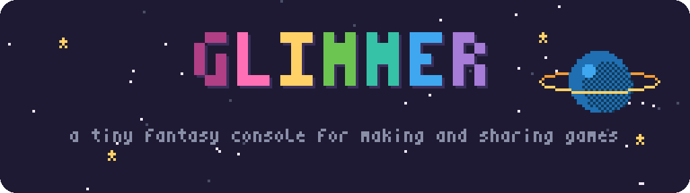
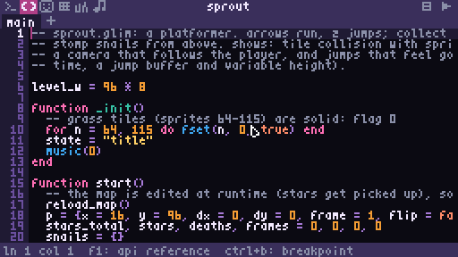
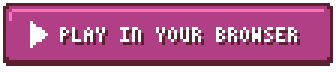
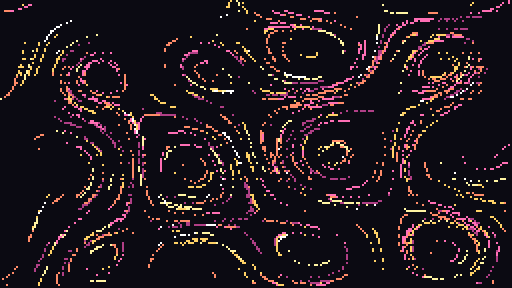

<div align="center">

<picture>
  <source media="(prefers-color-scheme: dark)" srcset="docs/assets/banner-dark.png">
  <source media="(prefers-color-scheme: light)" srcset="docs/assets/banner-light.png">
  
</picture>

**Make tiny games in Lua. Draw them, score them, and share them as a picture.**

[](https://github.com/aubergine-ux/glimmer/actions/workflows/ci.yml)
[](https://github.com/aubergine-ux/glimmer/releases)
[](LICENSE)
[](#install)
[](https://armd.one/glimmer/console/)

<br>



<br><br>

<a href="https://armd.one/glimmer/console/"></a>

</div>

<br>

Glimmer is an open-source **fantasy console**: a pretend retro computer with
deliberately tight limits and everything you need to make a game built in.
You get 256×144 pixels, 32 colors, 4 sound channels and a fixed CPU budget,
and you write the game in Lua. The limits are the fun part. They keep games
small enough to finish, and because every machine runs a cart exactly the
same way, you can share a game as a single file, or as a PNG of a cartridge
that *is* the game.

## ✨ Features

<table>
  <tr>
    <th width="33%">🛠️ Make</th>
    <th width="33%">🎮 Play</th>
    <th width="33%">🔗 Share</th>
  </tr>
  <tr valign="top">
    <td>
      <b>Code, sprite, map, sound and music editors</b> built into the console<br><br>
      ⌨️ autocomplete, signature hints and an F1 API reference<br>
      🗺️ auto-tiling, layers, onion skin, animation preview<br>
      🎵 a tracker with a piano keyboard and custom wavetables<br>
      🐞 breakpoints, stepping and a variables panel<br>
      🔁 hot reload: <kbd>Esc</kbd>, edit, <kbd>Esc</kbd>, keep playing
    </td>
    <td>
      <b>256×144, 32 colors, 4 voices, Lua 5.4</b>, and a fixed CPU budget so every machine plays the same<br><br>
      🎨 sprites that flip, stretch and rotate; fill patterns; palette swaps<br>
      🎹 a live synth with slides, vibrato and arpeggios<br>
      🕹️ up to 4 players on gamepads or rebindable keys<br>
      📺 pixel-perfect scaling or a CRT filter (<kbd>F9</kbd>)<br>
      🎬 <kbd>F6</kbd> screenshots, <kbd>F8</kbd> GIFs
    </td>
    <td>
      <b>One file, many ways out</b><br><br>
      🖼️ PNG cartridges with the game hidden in the pixels<br>
      🌐 links that play in any browser, touch controls included<br>
      📄 single-file HTML games<br>
      📦 standalone apps for Windows, macOS and Linux (itch.io-ready)<br>
      🧩 a <code>&lt;glimmer-player&gt;</code> web component for your site
    </td>
  </tr>
</table>

♿ **Accessible and translated:** rebindable controls, a high-contrast editor theme, an adjustable window
scale, and the whole console UI in English or Albanian. Carts made today keep working forever thanks to
a versioned [spec](SPEC.md), and CI checks every change on Windows, macOS, Linux and the web.

## 🕹️ Demo carts

Every demo is written to be read: open one in the editors and follow the comments.

<table>
  <tr>
    <td align="center" width="33%">
      <a href="https://armd.one/glimmer/play/?cart=sprout"></a>
      <br><b>sprout</b>: a platformer: run, jump, stomp snails, find every star
      <br><a href="https://armd.one/glimmer/play/?cart=sprout">▶ play</a> · <a href="carts/sprout.glim">source</a>
    </td>
    <td align="center" width="33%">
      <a href="https://armd.one/glimmer/play/?cart=starfall"></a>
      <br><b>starfall</b>: a vertical shooter with waves, power-ups and bombs
      <br><a href="https://armd.one/glimmer/play/?cart=starfall">▶ play</a> · <a href="carts/starfall.glim">source</a>
    </td>
    <td align="center" width="33%">
      <a href="https://armd.one/glimmer/play/?cart=crates"></a>
      <br><b>crates</b>: a box-pushing puzzle with undo and par scores
      <br><a href="https://armd.one/glimmer/play/?cart=crates">▶ play</a> · <a href="carts/crates.glim">source</a>
    </td>
  </tr>
  <tr>
    <td align="center" width="33%">
      <a href="https://armd.one/glimmer/play/?cart=loops"></a>
      <br><b>loops</b>: a step sequencer that builds its sounds at runtime
      <br><a href="https://armd.one/glimmer/play/?cart=loops">▶ play</a> · <a href="carts/loops.glim">source</a>
    </td>
    <td align="center" width="33%">
      <a href="https://armd.one/glimmer/play/?cart=bloom"></a>
      <br><b>bloom</b>: generative art: particles riding a flow field
      <br><a href="https://armd.one/glimmer/play/?cart=bloom">▶ play</a> · <a href="carts/bloom.glim">source</a>
    </td>
    <td align="center" width="33%">
      <a href="https://armd.one/glimmer/play/?cart=learn"></a>
      <br><b>learn</b>: an interactive tutorial that teaches Glimmer
      <br><a href="https://armd.one/glimmer/play/?cart=learn">▶ play</a> · <a href="carts/learn.glim">source</a>
    </td>
  </tr>
</table>

Two smaller examples, [hello](carts/hello.glim) and [orbit](carts/orbit.glim), show the basics and the drawing API.

## 👋 Hello, world

A whole game is a couple of functions. Run `glimmer`, type `new`, open the
code editor (<kbd>Alt</kbd>+<kbd>2</kbd>), type this and press
<kbd>Ctrl</kbd>+<kbd>R</kbd>. Or save it as `hello.lua` and
run `glimmer hello.lua`:

```lua
x = 128

function _update()
  if btn("left")  then x = x - 2 end
  if btn("right") then x = x + 2 end
end

function _draw()
  cls(1)
  circfill(x, 72, 8, 17)
  print("hello, glimmer!", 98, 30, 5)
end
```

Then share it:

```sh
glimmer --export hello.lua hello.png      # a picture that is the game
glimmer --export hello.lua hello.html     # a web page that plays it, touch controls included
glimmer --bundle hello.lua --out hello    # a standalone app (hello.exe on Windows)
```

Or embed it in any web page:

```html
<script src="https://armd.one/glimmer/embed.js"></script>
<glimmer-player src="https://example.com/hello.png"></glimmer-player>
```

## 📦 Install

**Download** a ready-to-run build for Windows, macOS or Linux from
[releases](https://github.com/aubergine-ux/glimmer/releases/latest). Unzip it
and drop a cart from `carts/` onto the window. The macOS app isn't signed yet,
so the first time, right-click it and choose **Open**.

**Build from source** if you prefer. It takes about a minute and needs CMake
3.24+ and a C++20 compiler.

<details>
<summary><b>🐧 Linux</b></summary>

```sh
# Arch
sudo pacman -S --needed cmake ninja sdl3
# Ubuntu 25.04+ / Debian 13+
sudo apt install cmake ninja-build g++ libsdl3-dev
# Fedora
sudo dnf install cmake ninja-build gcc-c++ SDL3-devel

git clone https://github.com/aubergine-ux/glimmer.git && cd glimmer
cmake -S . -B build -G Ninja -DCMAKE_BUILD_TYPE=Release
cmake --build build
./build/glimmer carts/orbit.glim
```

If your distro doesn't package SDL3 yet, add `-DGLIMMER_FETCH_SDL=ON` to the
first `cmake` command and SDL is built from source.

</details>

<details>
<summary><b>🍎 macOS</b></summary>

```sh
brew install cmake ninja sdl3

git clone https://github.com/aubergine-ux/glimmer.git && cd glimmer
cmake -S . -B build -G Ninja -DCMAKE_BUILD_TYPE=Release
cmake --build build
open build/glimmer.app --args "$PWD/carts/orbit.glim"
```

</details>

<details>
<summary><b>🪟 Windows</b></summary>

With Visual Studio 2022 (Desktop C++ workload) installed, open a *Developer PowerShell*:

```powershell
git clone https://github.com/aubergine-ux/glimmer.git; cd glimmer
cmake -S . -B build -DGLIMMER_FETCH_SDL=ON
cmake --build build --config Release
.\build\Release\glimmer.exe carts\orbit.glim
```

</details>

<details>
<summary><b>🌐 Web</b></summary>

Nothing to install: [open the console in your browser](https://armd.one/glimmer/console/).
To build it yourself with [Emscripten](https://emscripten.org):

```sh
emcmake cmake -S . -B build-web -DCMAKE_BUILD_TYPE=Release
cmake --build build-web
python3 -m http.server -d build-web   # then open http://localhost:8000/glimmer.html
```

</details>

**Controls:**

| Action | Keys |
|---|---|
| Move | arrow keys or d-pad |
| A / B / X / Y | <kbd>Z</kbd> <kbd>X</kbd> <kbd>A</kbd> <kbd>S</kbd> |
| L / R | <kbd>Q</kbd> <kbd>W</kbd> |
| Pause and edit / resume with changes | <kbd>Esc</kbd> |
| Restart the cart | <kbd>Ctrl</kbd>+<kbd>R</kbd> |
| Screenshot / record a GIF | <kbd>F6</kbd> / <kbd>F8</kbd> |
| Save | <kbd>Ctrl</kbd>+<kbd>S</kbd> |
| CRT filter | <kbd>F9</kbd> |
| Fullscreen | <kbd>F11</kbd> |
| Quit | <kbd>Ctrl</kbd>+<kbd>Q</kbd> |

Drop a `.glim`, `.png` or `.lua` cart onto the window to load it. The
[editor guide](docs/editors.md) lists every tool and shortcut.

## 📐 The console

| Part | Spec |
|---|---|
| **Display** | 256 × 144, 60 fps, integer-scaled |
| **Colors** | 32 from a programmable palette, with draw and screen palette swaps |
| **Sprites** | 8 × 8, 2 sheets of 256, 8 flags each |
| **Map** | 128 × 64 cells, 4 layers |
| **Sound** | 4 channels, 8 waveforms + 8 custom wavetables, 8 effects |
| **Music** | 128 patterns × 4 channels with loops |
| **Input** | 4 players × (d-pad + 6 buttons), mouse, keyboard |
| **CPU** | 1,000,000 cycles per frame |
| **Memory** | 256 KiB, all of it `peek`/`poke`-able |
| **Code** | Lua 5.4, up to 128 KiB |
| **Carts** | `.glim` text (diff-friendly) or `.png` cartridge pictures |

The full details are in [SPEC.md](SPEC.md), which is versioned so carts made
today still run in every future Glimmer.

## 📚 Documentation

| Document | What it covers |
|---|---|
| [API reference](docs/api.md) | Every function, with examples |
| [Editor guide](docs/editors.md) | Every tool and shortcut in the built-in editors |
| [Console spec](SPEC.md) | The virtual hardware, memory map and cart formats |
| [Architecture](ARCHITECTURE.md) | How the C++ is organised, system by system |
| [Contributing](CONTRIBUTING.md) | Building, testing and code style |
| [Changelog](CHANGELOG.md) | What changed, and when |

## 🗺️ Roadmap

- [x] **Core runtime:** graphics, synth, Lua, carts, PNG carts, CRT, web build
- [x] **Built-in editors:** code, sprites, map, sound effects, music tracker
- [x] **Shell and debugging:** boot shell, breakpoints, hot reload, GIF recording, cart browser
- [x] **Sharing:** web player export, embeddable player with touch controls, standalone native builds
- [x] **Demo carts and polish:** six showcase games, accessibility, translations (English and Albanian)

<br>

<div align="center">

**[MIT License](LICENSE)** · made by [aubergine-ux](https://github.com/aubergine-ux)

<sub>Built with
<a href="https://www.lua.org">Lua</a>,
<a href="https://libsdl.org">SDL</a>,
<a href="https://github.com/richgel999/miniz">miniz</a>,
<a href="https://github.com/nothings/stb">stb_image</a> and
<a href="https://github.com/doctest/doctest">doctest</a>.</sub>

</div>
